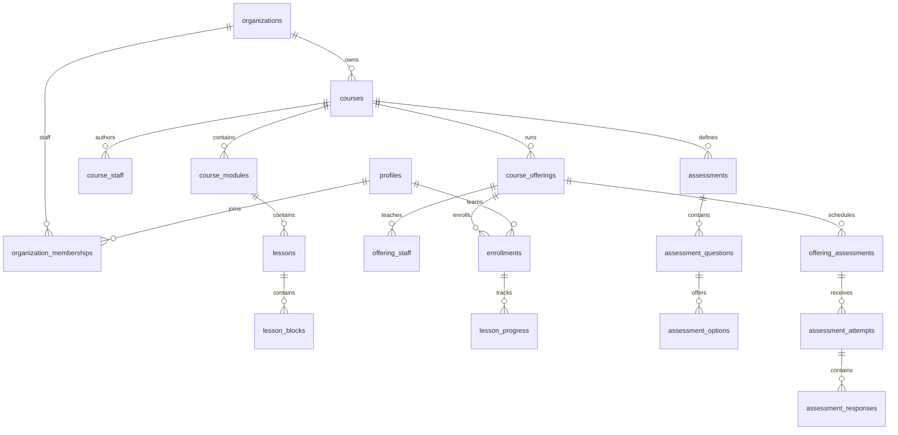

# Supabase database architecture

## Status and scope

The initial LMS database is applied to development project `gmvouqgjbtbkbhrdruzu`
(`https://gmvouqgjbtbkbhrdruzu.supabase.co`). PostgreSQL is the authority for the new
LMS model, permissions, enrollment, progress and assessments. SQL migrations are
the reproducible source of schema changes; browser visibility is never authorization.

The existing webpage is unchanged. Its current routes still use Clerk, Prisma and
the legacy database. This change prepares the Supabase persistence/authentication
foundation; it does **not** silently switch existing students or migrate legacy data.
Clerk string IDs are not Supabase UUIDs. Do not insert them into `profiles` or
trust Clerk sessions as Supabase sessions. The future Firebase phase must use
verified external identities mapped to stable application UUIDs; it must NOT
require creating a Supabase Auth account per Firebase user. See
[identity transition](identity-transition.md), [operations](database-operations.md)
and [verified implementation report](supabase-completion-report.md).

## Identity, tenants and roles

`auth.users` owns authentication. Its structure is unchanged. A private trigger
creates `public.profiles` with the same UUID. Only display name is copied from
user-editable metadata; no authorization comes from metadata or a profile role.

`organizations` are tenant boundaries. `organization_memberships` scopes
owner/admin/teacher/assistant roles and invited/active/suspended status to one
organization. A person can be a teacher in A and admin in B. Ordinary students
need no organization membership. Suspending a profile, membership or organization
removes current staff access through authorization helpers.

`create_organization(name, slug)` atomically creates an organization and its first
owner for an active authenticated user. Direct organization inserts are denied.
Owners manage other owners; admins manage non-owner memberships. A trigger prevents
removing the last active owner. Account/organization status changes require a
trusted administrative workflow; the self-profile API cannot activate itself.

Course staff must be active organization staff when assigned. `course_staff` adds
owner/instructor/assistant/editor roles; `offering_staff` adds instructor/teaching
assistant roles. No teacher ID or global teacher/student flag is authoritative.

## Content versus delivery



A course is reusable authored material. Modules and lessons are ordered relational
rows, and each lesson contains individually ordered blocks. Only genuinely
variable block configuration is JSONB. `media_assets` contains metadata and storage
references, never file bytes.

An offering is a specific run/cohort: dates, enrollment window, timezone, capacity,
delivery mode and status. One physics course can serve October Group A, October
Group B and a later cohort. Timezones are validated against PostgreSQL's timezone
catalog. Enrollment windows describe the intended admission period; this initial
release permits staff-managed enrollment only, so there is no self-enrollment flow.

Students enroll in offerings. `(offering_id,user_id)` is unique, and progress
references that enrollment. A trigger ensures a progress lesson belongs to the
offering's course. Progress is derived from individual lesson records, not a stored
course percentage. Capacity is serialized through an offering row lock when
activating enrollments. Cancel/suspend/archive records instead of deleting history.

## Assessment model and workflow

`assessments` and their questions/options define reusable assessment content.
`offering_assessments` schedules it for a particular cohort. Questions support
single/multiple choice, true/false, numeric, short text, essay and file upload.
True/false uses two options. Points and scores use bounded decimal `numeric`.

The approved student workflow is:

1. `start_assessment_attempt(offering_assessment_id)` checks enrollment, publishing,
   opening/closing times and attempt limits. It resumes an unexpired in-progress
   attempt and serializes new numbering. It snapshots maximum points and the
   deadline; expiration consumes an attempt. An expired attempt is submitted when
   the student requests a new attempt (transaction rollback on a rejected request
   leaves the expired attempt unchanged, still unable to accept answers).
2. `save_assessment_response(attempt_id, question_id, response, media_asset_id?)`
   checks ownership, enrollment, the question's assessment, status and deadline.
   Choice payloads contain `option_ids`; numeric payloads contain `value`; text
   payloads contain `text`. Files use a relational media FK. Duplicate/out-of-question
   option IDs and grading fields in response payloads are rejected.
3. `submit_assessment_attempt(attempt_id)` freezes student edits. Late submission
   is permitted, while answer saves stop at the snapshotted deadline.
4. Authorized offering staff call `grade_assessment_response(response_id, points,
   feedback?)` and `finalize_assessment_grade(attempt_id)`. Unanswered questions
   earn zero; all submitted responses must be graded before finalization. The
   workflow automatically grades single choice, multiple choice and true/false
   using exact-set, all-or-nothing marking. Numeric grading requires an explicit
   private key: `{"kind":"numeric","value":12.5,"absolute_tolerance":0.01}`.
   The tolerance boundary is inclusive. Subjective questions, numeric questions
   without a key, and malformed choice keys remain for manual grading. Automatic
   grading does not publish results; staff must explicitly finalize them.
5. `get_assessment_results(attempt_id)` releases one's own points and feedback
   only after finalization; authorized offering staff can inspect pending grading.

Attempts/responses cannot be inserted or graded directly by authenticated clients.
Persisted response JSON is limited to 65,536 bytes; future HTTP adapters still
need transport request limits and per-user rate limits.
All sensitive state transitions use identity-bound RPCs. Assignment configuration
such as shuffle flags is stored; presentation shuffling and per-question UI
validation belong to the future assessment application integration.

### Answer keys and versioning

RLS protects rows, so it cannot by itself hide `is_correct`. `assessment_options`
has **column-level SELECT grants** excluding correctness. Students must request
`id,question_id,text,position`, never `*`. Even assigned instructors use
`get_assessment_answer_keys(assessment_id)` for correctness. Numeric/text grading
answers and rubrics live in `private.assessment_answer_keys`, with no direct
application-role access. `set_assessment_answer_key(question_id, answer)` permits
course editors to author them. Public question settings have a UI-only allowlist
and must not contain grading answers.

Any attempt permanently freezes its assessment, questions, options, private answer
keys and existing delivery configuration. Trigger locks serialize edits against
attempt creation. `clone_assessment(assessment_id,title?)` produces a draft version
with new question/option UUIDs, copied keys and `supersedes_assessment_id`. Publish
and schedule the clone for future attempts; never mutate historical assessment
rows. PostgreSQL may abort conflicting lock orders; application writes must retry
serialization/deadlock errors rather than disable the guards. Course content is
currently reusable live content, not snapshotted per cohort; published lesson
revision history is a separate future extension.

## RLS and API grants

All 19 public application tables have RLS enabled and explicit grants. No anonymous
catalog is exposed; `public` visibility is reserved for a future deliberately
whitelisted catalog API. No privileged views or public SECURITY DEFINER functions
are introduced.

Reusable helpers live in the non-exposed `private` schema. SECURITY DEFINER
implementations use an empty fixed search path, qualified references and
`private.current_app_user_id()`, currently a direct `auth.uid()` delegation. They
bypass underlying RLS solely to evaluate authorized contextual
relationships without recursive policies. Execution is revoked from PUBLIC/anon
and granted only where required. Public RPC wrappers are SECURITY INVOKER.
Keep `private` out of the project's exposed Data API schemas.

| Identity/context | Allowed access |
| --- | --- |
| Organization owner/admin | Tenant courses/offerings/staff and enrolled student records; admins cannot grant/change ownership |
| Assigned course owner/instructor/editor | Author assigned content and assessment versions; editor cannot manage offering rosters just from editing permission |
| Assigned offering instructor | Its offering, enrollment management, submissions and grading; course authoring requires a separate course permission |
| Offering teaching assistant | Assigned offering roster/progress/submissions/grading; no offering/enrollment/staff management |
| Active enrolled student | Only enrolled active offerings, published lessons/assessments, own progress/attempts/responses and released grades |
| Anonymous | No application tables or write/grading RPCs |

Staff roster access includes necessary profiles; students cannot list classmates'
profiles, phone numbers or academic records. Students can retain access to their
own historical attempt results/enrollment record, even after enrollment ends, but
cannot continue reading private teaching content or submitting answers.

Identity/parent links are immutable. Cross-tenant media, cross-course assessment
assignments and cross-course lesson progress are rejected by integrity triggers.
Foreign-key indexes complement existing unique/primary indexes without duplicating
their leading prefixes. Historical enrollments, attempts/responses and referenced
content use restrictive deletion. Deleting `auth.users` can be blocked by LMS
history: implement privacy-preserving anonymization/retention rather than removing
constraints or cascading away academic records.

## Storage

Private buckets `lms-course-media` (50,000,000 bytes) and `lms-submissions` (20 MiB) have
restricted MIME types. Existing UploadThing files are unaffected. To use Supabase
uploads, generate an asset UUID and create its metadata before uploading at
`<organization UUID>/<asset UUID>/<filename>`. Student submissions additionally
scope metadata to an offering, with enforced organization consistency.

Storage INSERT requires unexpired pending metadata owned by the caller, matching
object `owner_id` to the verified JWT subject, and either tenant teacher permissions
or active student enrollment. Uploads expire after 24 hours. SELECT requires ready
metadata plus authorized media/content access. `complete_media_upload(asset_id)`
verifies object ownership, actual size, MIME type and the bucket limit. Clients
cannot insert ready status or spoof provider/expiry/size. Completion and abandonment
are idempotent. There are no client overwrite/delete policies; replacements use new
paths. Lesson and submission references require completed assets.

`private.expired_media_uploads` queues only unreferenced expired/abandoned assets.
The operator-only `scripts/lms-storage-maintenance.cjs` defaults to dry-run, claims
expired metadata as archived, then removes objects via Storage API only when
explicitly run with `--apply`. No cleanup was activated or actual objects removed
in this task. Run maintenance regularly once uploads are enabled; a script alone
does not schedule itself. Unregistered objects are counted for manual review and
never automatically deleted. Ready academic media is never selected for cleanup.

Provider values `supabase`, `r2`, `external` preserve stable asset UUID references.
The typed storage port abstracts transport. R2 transport/credentials are not
implemented. Current bucket names act as logical containers; future adapters map
them to physical containers. Do not store permanent public URLs for private files.

## TypeScript clients and configuration

- `shared/contracts/database.types.ts` is generated from the connected schema.
- `frontend/lib/supabase.ts` creates a typed browser client lazily.
- `server/integrations/supabase.ts` creates a request-scoped cookie client for
  Route Handlers/Server Actions that can write cookies. Do not call it from a
  read-only Server Component that would need to refresh a session.
- Both use only `NEXT_PUBLIC_SUPABASE_URL` and
  `NEXT_PUBLIC_SUPABASE_PUBLISHABLE_KEY`. Runtime validation requires an
  `sb_publishable_` key, rejecting legacy JWT/service/secret keys.
- `.env.local` is configured locally and ignored by Git. `.env.example` documents
  configuration without secrets. Never share a user client across server requests.

`shared/contracts/lms.ts` defines repository/storage ports. The server repository
uses bounded queries, safe option/response selects, verified-session progress IDs
and checked workflow RPCs. It supports read access across the entire LMS model,
progress writes, media registration/completion/abandonment and exam/grading commands.
General teacher content CRUD remains a later UI/service integration, not a claimed
complete admin application. `server/services/lms-staging.ts` requires the server
flag `LMS_DATA_BACKEND=supabase-staging`, a verified `auth.getUser()` identity and
an active profile. Default `legacy` fails closed before constructing a client.
No live route invokes it. No new Supabase login flow or auth bridge was added.
The future Firebase phase must replace this session adapter and identity resolver
with verified external-token handling. Never use client-supplied identity UUIDs.

## Migrations and reproducibility

Use the official CLI (tested with 2.120.0):

```powershell
npx supabase migration new descriptive_change_name
# Edit the generated file in supabase/migrations; review SQL before applying.
npx supabase start
npx supabase db reset
npx supabase db query --help
npx supabase db advisors --local --type all
```

Docker is required for the local stack and was not installed in this workspace.
The connected development project was tested directly via the official Supabase
MCP. Apply checked-in SQL using MCP `apply_migration({name,query})`, then reconcile
the local filename timestamp with `list_migrations` (MCP assigns its own migration
version). Do not rewrite applied SQL: add a corrective migration. Verify remote
versions match Git before a later `db push`, to avoid duplicate application.

For CLI remote deployment, log in with a personal access token locally, link the
correct project, review `db push --dry-run`, and then push. No access token or
database password belongs in Git. Development seed data is explicitly separate
from migrations. `supabase/seed.sql` creates two demonstration organizations,
seven dormant synthetic users, multiple teachers, differing tenant roles,
multiple course staff, three offerings and three separate student enrollments.
Accounts use `.invalid` emails, no password/identity and an infinite sign-in ban.
Never load these demo identities into production or remove their ban to enable login.

## Verification and advisors

`supabase/tests/authorization.sql` runs as postgres on a seeded **development**
database. It switches to actual `authenticated`/`anon` roles with transaction-local
JWT claims. All fixtures, attempts, grades and helper functions roll back. It fails
immediately on incorrect access, rather than merely printing results.

The original suite passed **71 checks** again, including non-vacuous peer attempt,
response/progress isolation, tenant isolation, answer-key and grade tampering,
draft lesson isolation, legitimate grading, immutable history, version cloning,
bootstrap ownership, attempt limits, suspension revocation and submission-file
privacy. The new `hardening.sql` passed **51 additional checks** for objective
grading, numeric rules, retries, expiration, upload ownership/size/MIME, identity
mapping privileges and suspended access. Application tests (**29**), boundary
checks, TypeScript checks and lint also passed (pre-existing lint warnings remain).
The optimized production build passed with the existing Clerk/Edge warnings.
Anonymous REST requests with the publishable key were denied (`401`, SQLSTATE
`42501`), and requesting the `private` API schema returned `406`/`PGRST106`,
confirming that it is not exposed by the connected project's Data API.

The official MCP security and performance advisors are now available and were run.
Security has one WARN: leaked-password protection is disabled; Supabase documents
this as a Pro feature. No upgrade or new password login was enabled. Two INFO
findings are intentional deny-all RLS on private answer-key/identity tables.
Performance has only unused-index INFO findings; no missing-FK or RLS performance
WARN/ERROR. Keep required authorization/FK indexes on this tiny database.

Two-session concurrent capacity checks admitted exactly one of two students into
a capacity-one test offering. Concurrent starts created exactly one attempt;
concurrent saves created exactly one response; concurrent submits preserved one
submitted response with the correct automatic grade. Test-only fixture rows were
cleaned up and baseline counts restored. See `supabase/tests/concurrency.md`.
These are SQL-role regression tests, not verified-login HTTP capacity measurements.
The 50/100/200 HTTP harness is prepared but was not run: the project only has banned
synthetic identities and no authorized real student test sessions. No concurrency
capacity, latency, CPU or memory guarantee is claimed.

## Remaining integration and extension points

- In a separate phase, integrate Firebase with verified issuer/subject mappings,
  detach the profile/auth.users FK safely, and migrate Prisma reads/writes with
  reviewed data mapping, backups and rollback planning.
- Connect the existing teacher/student UI to offerings, safe option selects,
  assessment RPCs and private media downloads. Do not merge cohorts into courses.
- Implement auth refresh/callbacks, real invitation/onboarding flows, endpoint rate
  limits, upload completion/retention and per-question validation in the UI/API.
- Run real authenticated HTTP capacity tests and concurrent owner changes before
  launch; SQL concurrency regressions passed but do not establish Free-tier capacity.
- `npm audit` reports 44 dependency vulnerabilities, including 4 critical findings
  in the legacy dependency graph (`next`, `@clerk/nextjs`, `form-data`,
  `protobufjs`). Neither added Supabase package is listed as vulnerable. Upgrading
  the legacy stack is a separate required production-hardening task.
- `live_sessions` should reference offerings; attendance should reference sessions
  and enrolled users. Legacy group schedules remain untouched pending migration.
- `organization_invitations`, `notifications`, `audit_events`, `webhook_events`
  extend tenant/identity/event handling later; webhook event IDs must be unique
  for idempotency. No unused event infrastructure is introduced here.
- Future `orders`, `order_items`, `payments` reference tenant/customer and offering
  access grants. Store money in integer minor units plus ISO currency, never float.
- Add submission revisions/regrading records and immutable course revisions when
  their actual product workflows are specified. Grade correction currently requires
  a reviewed trusted workflow; students/instructors cannot reopen finalized grades.
